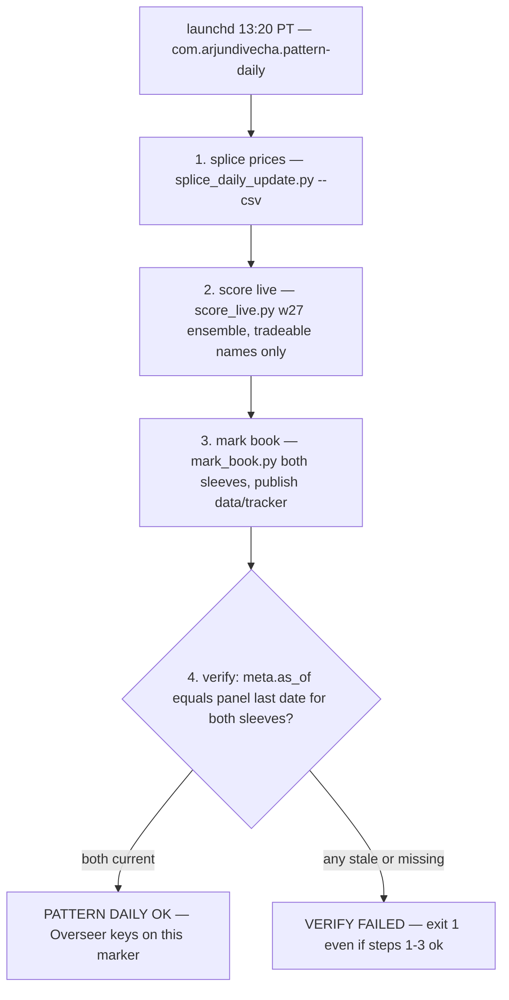

# Workflows

This page covers the end-to-end workflows: data building, training (debug and production), multi-GPU orchestration, backtesting, live scoring, pathway merging, and the daily publishing job that feeds the Tracker paper book.

---

## Data Building

### R1000 Database (`src/build_r1000_database.py`)

Builds a point-in-time historical database of every stock that was ever a Russell 1000 member (1996–present), including delisted names.

**Three phases:**
1. **Constituents** — For each year-end, calls Bloomberg `INDX_MEMBERS BDS` on `"RIY Index"` with `END_DT` override. Per-year JSON saved for crash recovery.
2. **Consolidate** — Deduplicates tickers across years, pulls metadata (name, GICS sector, exchange, SEDOL). Writes `data/constituents/master_tickers.xlsx`.
3. **OHLCV** — Pulls daily OHLCV + total-return index for every ticker from 19960101 to today via `hist_batch()` (50 tickers per Bloomberg request). Each batch saved as staging parquet for resume safety. Final step combines into `data/r1000_ohlcv_database.csv` and `.parquet`.

**Prerequisites:** Bloomberg Terminal running on Windows/Parallels, `blpapi`, `BBGExtended`. Expected runtime: 1–3 hours.

### NKY 225 Database (`src/build_nky_database.py`)

Analogous to R1000 but for the Nikkei 225. Uses `INDX_MWEIGHT_HIST` on `"NKY Index"`. Early years (pre-2005) backfilled with earliest non-empty year's member list (NKY 225 has ~5% annual turnover).

### Classification Pull (`src/pull_r1000_classifications.py`)

Pulls both GICS and BICS sector/industry classifications from Bloomberg for every ticker in the R1000 prediction universe. Outputs `data/r1000_classifications.{xlsx,parquet}` with columns for GICS sector/industry group/industry/sub-industry and BICS levels 1–3.

### ETF Data (`scripts/fetch_etf_data.py`)

Pulls daily OHLCV from yfinance for every ticker in `AssetList.xlsx` (34 country ETFs). Output schema matches `r1000_ohlcv_database.csv` so the existing pipeline consumes it unchanged.

### SSE Data (`scripts/fetch_sse_data.py`)

Fetches OHLCV for single-stock ETF underlyings and their leveraged wrappers (e.g., TSLA → TSLQ/TSLZ). Validates pair availability via yfinance.

---

## Training

### Debug Run (local)

```bash
python -m pattern.cli train --config configs/debug.yaml
```

Uses `configs/debug.yaml`: 3-year train/val, 2-year test, single window, MPS device, W&B enabled. Good for smoke testing on a laptop.

### Production Expanding-Window (multi-GPU)

```bash
# 1. Pre-build the image cache (~20 GB, once)
python scripts/run_multi_gpu.py --config configs/prod_expanding.yaml --prebuild-cache

# 2. Train on 8 GPUs
python scripts/run_multi_gpu.py --config configs/prod_expanding.yaml --n-gpus 8
```

Uses `configs/prod_expanding.yaml`: 28 expanding windows anchored at 1996. Window 0 trains on 1996–98, tests 1999. Window 27 trains on 1996–2025, tests 2026. Each window trains a 5-seed ensemble (140 total networks). Cache is shared across all windows and GPUs (read-only after build).

### Production Rolling-Window (multi-GPU)

```bash
python scripts/run_multi_gpu.py --config configs/prod_rolling.yaml --n-gpus 8
```

Uses `configs/prod_rolling.yaml`: window expands from 3 years up to 5 years, then trails at 5 years. Same shared cache as expanding, and the same 28 test years (1999–2026) as the expanding pathway.

### Full-History Live Model (`scripts/train_full_for_live.py`)

Trains one 5-seed ensemble on the entire image cache (1996 to present) with no validation/test split. Supports equal-weight or EWMA (exponentially-weighted moving average) sample weighting. This is the final model used by the live scoring webapp.

```bash
python scripts/train_full_for_live.py --config configs/prod_expanding.yaml --tag equal
python scripts/train_full_for_live.py --config configs/prod_expanding.yaml --tag ewma_5yr --weight-mode ewma --half-life-years 5
```

### Extra Seeds (`scripts/train_extra_seeds.py`)

Adds additional ensemble members to an existing run directory.

---

## Multi-GPU Orchestration

### Static Round-Robin (`scripts/run_multi_gpu.py`)

Enumerates all windows for a config, assigns them round-robin to GPUs 0..N−1, spawns one subprocess per GPU with `CUDA_VISIBLE_DEVICES` pinned and `--window-indices` set to that GPU's shard. Each subprocess sees only its one device as `cuda:0`.

After all shards finish, the driver concatenates per-window prediction parquets into `predictions.parquet` and prints an AUC check.

### Work-Stealing Scheduler (`scripts/gpu_scheduler.py`)

Polls `nvidia-smi` every 30 seconds; whenever a GPU has no compute apps attached, pops the next pending window index from the queue and launches a training subprocess on that GPU. Used to pipeline the rolling pathway on GPUs freed by the expanding run.

```bash
python scripts/gpu_scheduler.py \
    --config configs/prod_rolling.yaml \
    --run-dir /data/Pattern/runs/rolling/<ts> \
    --n-windows 28 --n-gpus 8
```

Per-window logs go to `shard_gpu{g}_w{w:02d}.log`. Exits when the queue is empty and all launched shards have finished.

---

## Backtesting

### Standard Backtest

```bash
python -m pattern.cli backtest --config configs/prod_expanding.yaml \
    --run-dir runs/expanding/<timestamp_hash>
```

Loads `predictions.parquet` from the run directory, builds decile portfolios, computes metrics, and writes `report.md`, `backtest_*.{pdf,xlsx,parquet}`. See [Architecture](architecture.md#backtest-layer) for details.

### Generic Backtest (`scripts/backtest_generic.py`)

Reusable backtest over any `predictions.parquet` + optional universe filter. Ranks tickers cross-sectionally by `p_up_mean`, builds top X% / bottom X% portfolios, computes Sharpe, NW t, turnover, and yearly stats. Used as the foundation for most slicing experiments.

### Cross-Sectional Slicing Scripts

| Script | Purpose |
|---|---|
| `backtest_by_sector.py` | LS by BICS sector/industry |
| `backtest_by_mcap_proxy.py` | LS by dollar-volume tertiles |
| `backtest_by_feature.py` | LS by momentum, realized vol, prediction disagreement |
| `backtest_trash_tier.py` | Intersection of small + high-vol + recent-loser filters |
| `backtest_liquid_grid.py` | 27-cell grid search (dv × vol × mom) with cost-adjusted net returns |
| `trash_tier_turnover.py` | Month-over-month ticker turnover for trash-tier |
| `trash_tier_yearly.py` | Per-calendar-year LS return and turnover |
| `backtest_sse.py` | Backtest using single-stock ETF wrappers as trading instruments |
| `backtest_sse_momentum.py` | Alternative momentum signals on SSE universe |

See [Domain & Strategy](domain.md) for the research findings from these scripts.

---

## Live Scoring

### Batch Live Scoring (`scripts/score_live.py`)

Scores the tail of trading days (no forward return available yet) using the most recent expanding-window checkpoint (**w27**, trained on 1996–2025; default `--src-run runs/expanding/20260419_174908_cdef6809`). Pixel stats reuse the pre-existing cache rows as a reference so normalization matches the labeled pathway.

```bash
python scripts/score_live.py \
    --data-csv data/etf_ohlcv.csv \
    --out-parquet runs/etf_expanding/live_predictions.parquet
```

**Tradeable-universe guard.** When `--tickers-csv` points at
`data/r1000_tradeable_universe.csv` (the staleness manifest written by
[`splice_daily_update.py`](#price-splice-scriptssplice_daily_updatepy)), `score_live.py`
drops names with `tradeable=False` before scoring — a stale price silently
poisons `dv_60d`/`vol_60d`/`mom_12_1` and can put a name in the wrong tertile. In
the [daily job](#daily-publishing-job-scriptsrun_dailysh) it is invoked with
`--tail-days 160 --cadence monthly --device mps` against the spliced panel.

**Rebalance guard.** `score_live.py` emits the current day as the canonical
"month-end" of the running month. Left unhandled, the [book marker](#tracker-paper-book-scriptsmark_bookpy)
would treat every run day as a rebalance (daily turnover on a monthly
strategy); `mark_book.py` therefore drops prediction dates falling in the latest
incomplete calendar month so the book set at the last completed month-end is
held through the current one.

### Expanding-Window Scoring (`scripts/score_with_expanding.py`)

Scores a data file using the full expanding-window ensemble (all 28 windows).

### Webapp (`webapp/`)

FastAPI application for interactive single-ticker scoring. Fetches OHLCV from yfinance, renders the I20 chart, runs the full-history 5-seed ensemble, and maps raw `P(up)` to a 0–100 score using historical distribution anchors.

```bash
cd webapp && uvicorn main:app --reload --host 0.0.0.0 --port 8000
```

Score mapping (from expanding pathway distribution):
- Score 0 → P(up) = 0.221 (absolute min observed)
- Score 50 → P(up) = 0.500 (neutral)
- Score 100 → P(up) = 0.663 (absolute max observed)

---

## Pathway Merge (`scripts/merge_pathways.py`)

Joins expanding and rolling prediction parquets on `(ticker, end_date)` so each stock-date has both ensembles' probabilities, ranks, and deciles.

```bash
python scripts/merge_pathways.py \
    --expanding runs/expanding/<ts> \
    --rolling   runs/rolling/<ts> \
    --out-dir   runs/comparison
```

Outputs:
- `pathway_comparison.parquet` — one row per `(ticker, end_date)` with both pathways' `p_up_mean`, `p_up_std`, rank, decile
- `pathway_comparison_summary.csv` — per-date correlation, rank correlation, decile disagreement rate

---

## Inference (`scripts/infer_fullperiod.py`)

Re-scores saved ensembles over any date range. Loads all 5 state_dicts, stacks each layer's weights into a grouped convolution for a single forward pass, and runs on MPS/CPU. Used to re-evaluate old checkpoints with updated architecture params.

---

## Cost Analysis (`scripts/ibkr_triple_tier_costs.py`)

Connects to Interactive Brokers TWS/Gateway via `ib_insync` to pull live bid/ask, short-availability, and 30-day historical spread data for the triple-tier-filter universe. Re-prices the monthly portfolios with observed IBKR spreads instead of the Corwin-Schultz proxy.

**Prerequisites:** TWS or IB Gateway running, API enabled, `ib_insync` installed. Requires a Python 3.14 compatibility shim for `ib_insync` event-loop autocreate.

```bash
python scripts/ibkr_triple_tier_costs.py \
    --predictions runs/expanding/20260419_174908_cdef6809/predictions_monthly.parquet \
    --ohlcv       data/r1000_ohlcv_database.parquet \
    --out-dir     runs/expanding/20260419_174908_cdef6809/ibkr_costs \
    --ib-host 127.0.0.1 --ib-port 7496 --ib-client-id 42 \
    --aum-per-side 5e6 --min-adv 5e6 --adv-cap 0.10 --c-impact 1.5
```

---

## Price Splice (`scripts/splice_daily_update.py`)

Extends the Bloomberg OHLCV panel forward with yfinance so the pipeline refreshes
daily without a Bloomberg pull. Bloomberg remains the history of record and is
opened **read-only** (never rewritten); yfinance supplies only dates *after* the
Bloomberg panel ends.

**The one thing that matters — `AdjClose` is chained, not appended.** The two
`AdjClose` columns are not on the same scale: Bloomberg's total-return index
accumulates dividends forward from 1996; yfinance's Adj Close is back-adjusted
from today (measured level ratios on 2026-04-17: AAPL 1.19, MSFT 1.64, JNJ 2.10).
Concatenating them would inject a fake 20–110% one-day return at the seam, so
`AdjClose[t] = AdjClose_bbg[splice] × Π(1 + yf_adj_return)` for `t > splice`. Raw
Open/High/Low/Close/Volume are appended directly — verified to match Bloomberg
exactly (return correlation 1.000000 on 198/198 sampled tickers).

**Safety guards enforced here:**
- Only tickers whose Bloomberg history reaches the panel's last date (within
  `--max-gap-days`) are extended — a name that went dark in 2005 is **not**
  resurrected, since its ticker may since have been reassigned to another
  company.
- Every extended ticker is validated on an overlap window before acceptance;
  failures (e.g. APTV, BDX, both real spinoffs with overlap corr 0.67/0.99) are
  quarantined and reported, never silently spliced.
- Output is written atomically (temp file then rename).
- A ticker that fails to extend keeps its Bloomberg history and goes STALE.

**Staleness manifest.** Every run writes
`data/r1000_tradeable_universe.csv` (`Ticker, yf_ticker, last_date, stale_days,
tradeable`). Daily scoring (and the [Tracker marker](#tracker-paper-book-scriptsmark_bookpy))
must drop `tradeable=False` names because a stale price silently poisons
`dv_60d`/`vol_60d`/`mom_12_1` and can put a name in the wrong tertile. Known
free-source holes (2026-08-04): 33 of 1,371 names (2.4%) do not extend — BK, CTRA
and VSCO hard-404 on Yahoo despite being live liquid companies; others return
fragmentary history.

**Outputs:** `data/r1000_ohlcv_spliced.{parquet,csv}` (Bloomberg + yfinance,
same schema, written with `--csv`), `data/r1000_tradeable_universe.csv`, and a
per-run report under `runs/splice/<TIMESTAMP>/` (`splice_report.xlsx`,
`splice_summary.json`, `splice.log`).

```bash
python scripts/splice_daily_update.py --csv     # daily refresh
```

**Index membership cadence:** refresh from Bloomberg once a year, right after
the June reconstitution. Deletions self-resolve (dead names stop returning
yfinance data, go stale, drop out); additions are the only real gap (~150–200
names/yr enter the R1000) but a new entrant is not scoreable for ~13 months
anyway (20 days for the image + 273 days for `mom_12_1`). Caveat: tertile
boundaries drift as the universe ages — one year (~15% turnover) is tolerable,
two or more degrades the buckets; the trash tier is most sensitive because it
lives at the R1000/R2000 boundary where churn is highest.

Source: README.md §J.6.

---

## Tracker Paper Book (`scripts/mark_book.py`)

Builds and marks the Pattern CNN long/short book so the external **Tracker** hub
can read a daily NAV. Tracker is read-only and never runs this — Pattern
publishes, Tracker consumes. Two sleeves are published; both are 50/50
dollar-neutral long/short inside a cross-sectional cell, marked daily but
rebalanced on the 20-day cycle:

| Sleeve | Cell | Names | Spread | Capacity |
|---|---|---|---|---|
| `pattern-trash` | Low-dv × High-vol × Low-mom | ~90–125 | ~25 bp half-spread, hard borrow | $500k–$1M/side |
| `pattern-megacap` | High-dv × High-vol | ~126–147 | ~2.5 bp half-spread, easy borrow | deepest |

See [Domain — Tracker Paper Book](domain.md#tracker-paper-book) for the sleeve
rationale, and [Domain — Return-Convention Corrections](domain.md#return-convention-and-price-floor-corrections-addenda-jk)
for why this marker uses real portfolio arithmetic (simple returns, held
shares) instead of the mean-log statistic in the published backtests.

**Mechanic.** At each rebalance date the cell is selected, ranked by `p_up_mean`,
split 50/50 long/short, each leg equal-weighted; those names are held fixed
until the next rebalance and marked every day. Leg return is measured from the
rebalance close on an AdjClose (total-return) basis. A **$5 price floor**
(`MIN_PRICE = 5.0`) is applied at selection so the tracked book is the
deployable one, not the sub-penny-contaminated one ([README §J](domain.md#return-convention-and-price-floor-corrections-addenda-jk)).
The price floor is applied **before** bucketing (same order as
`backtest_liquid_grid.py --min-price`); filtering after bucketing would leave a
different, smaller cell than the backtest reports.

**Backtest/paper split.** Everything up to the last backtest date is `backtest`
and everything after is `paper`, recorded in a `track` column; `meta.json`
carries `paper_start`. The backtest leg has already been revised twice (README
addenda J and K) and must not quietly become the track record.

**Outputs (one directory per sleeve, under `data/tracker/<sleeve>/`):**
- `nav_daily.csv` — `date, nav, ew_cell, leg_long, leg_short, n_long, n_short, track`. Column shape matches what FDT publishes, so the sleeve drops into Tracker's `STRATEGY_PERF` with no template change.
- `holdings_latest.csv` — `ticker, side, weight, p_up_mean, entry_date, px_entry, px_last, ret_since_entry`.
- `meta.json` — `as_of, paper_start, n_positions, n_long, n_short, nav, cagr_pct, sharpe, since_2020, since_2015, flags, generated`. The `flags` list records that returns are gross of costs, that NAV is an index not dollars, that the book requires single-stock shorting, that the $5 floor is applied, and that the backtest leg before `paper_start` is not a track record.
- `sleeves.json` — index at `data/tracker/` summarizing both sleeves.

```bash
python3 scripts/mark_book.py                      # both sleeves, full history
python3 scripts/mark_book.py --sleeve pattern-trash
python3 scripts/mark_book.py --start 2020-01-01   # shorter backfill
```

**Inputs:** `data/r1000_ohlcv_spliced.parquet` (from the [splice](#price-splice-scriptssplice_daily_updatepy)),
`data/r1000_tradeable_universe.csv` (stale names dropped),
`runs/expanding/20260419_174908_cdef6809/predictions_monthly.parquet` (backtest
leg, through 2026-03-19), and `runs/live/live_predictions.parquet` (paper leg,
w27 ensemble applied to recent month-ends from `score_live.py`).

**Registered in Tracker.** `pattern-trash` and `pattern-megacap`, both
`mode: paper`, `cadence: daily`, `track: true`, read by
`collect_pattern_sleeve` in Tracker's `scripts/adapters.py`; perf packs build
via `build_perf_report.py --strategy pattern-trash`. Not yet wired: a holdings
page needing a `(list[HoldingRow], BookCharacteristics)` loader — the book
itself is published to `holdings_latest.csv` and the hub row carries the
position count. See `MEMO-TRACKER-INTEGRATION.md` for the integration contract.

---

## Daily Publishing Job (`scripts/run_daily.sh`)

The Pattern daily job. Publishes the artifacts Tracker reads — Tracker is
read-only and never runs this. Scheduled **13:20 PT on weekdays** via the
launchd plist `scripts/com.arjundivecha.pattern-daily.plist` (install with
`cp scripts/com.arjundivecha.pattern-daily.plist ~/Library/LaunchAgents/ &&
launchctl load ~/Library/LaunchAgents/com.arjundivecha.pattern-daily.plist`),
after the 13:00 PT US close so yfinance carries same-day closes and ~25 min
before Tracker's 13:45 PT consolidation. The job takes roughly 8–12 minutes,
dominated by image rendering in `score_live`. Registered with the NightWatch
Overseer as `pattern-daily`, so a missed or broken run alerts instead of going
silent.

```bash
zsh scripts/run_daily.sh      # splice -> score -> mark -> verify (~10 min)
```



*Daily publishing job: splice → score → mark → verify, with a verify gate that refuses to report success on stale artifacts.*

**Four steps:**
1. `splice_daily_update.py --csv` — extend the Bloomberg panel with yfinance ([Price Splice](#price-splice-scriptssplice_daily_updatepy)).
2. `score_live.py` — w27 ensemble → today's `p_up`, tradeable names only ([Batch Live Scoring](#batch-live-scoring-scriptsscore_livepy)), invoked with `--data-csv data/r1000_ohlcv_spliced.csv --cache-dir cache/r1000_I20_monthly --tickers-csv data/r1000_tradeable_universe.csv --out-parquet runs/live/live_predictions.parquet --tail-days 160 --cadence monthly --device mps`.
3. `mark_book.py --start 1999-01-01` — build/mark both sleeves, publish ([Tracker Paper Book](#tracker-paper-book-scriptsmark_bookpy)).
4. **verify** — refuses to report success on stale artifacts.

**Why step 4 exists.** Steps 1–3 can each `exit 0` while republishing
yesterday's numbers — e.g. yfinance returns nothing, the splice adds no rows,
and `mark_book` happily re-marks the stale panel. The verify step compares
each sleeve's `meta.json` `as_of` against the spliced panel's own last date and
prints the success marker **`PATTERN DAILY OK`** only when both match, so the
Overseer keys on proof of the *action* rather than an exit code. A sleeve whose
`as_of` lags the panel (or whose `meta.json` is missing) fails verify with
`VERIFY FAILED` and a non-zero exit.

**launchd-safe execution.** `run_daily.sh` is rewritten for launchd: `#!/bin/zsh`,
explicit `PATH` (launchd supplies almost no environment), absolute interpreter
path (`/opt/homebrew/bin/python3`), `set -uo pipefail`, and `exec > >(tee -a
"$LOG") 2>&1` so the full run logs to `logs/daily/YYYY-MM-DD.log` (which the
Overseer reads). Working directory is the Pattern repo root.

**Outputs Tracker reads:** `data/tracker/{pattern-trash,pattern-megacap}/`
(`nav_daily.csv`, `holdings_latest.csv`, `meta.json`), `runs/live/live_predictions.parquet`,
and `logs/daily/YYYY-MM-DD.log`. The full output tree is documented in
[Operations — Run Directory Layout](operations.md#run-directory-layout).

Source: `scripts/run_daily.sh`, `scripts/com.arjundivecha.pattern-daily.plist`,
README.md §K.5, `MEMO-TRACKER-INTEGRATION.md`.
